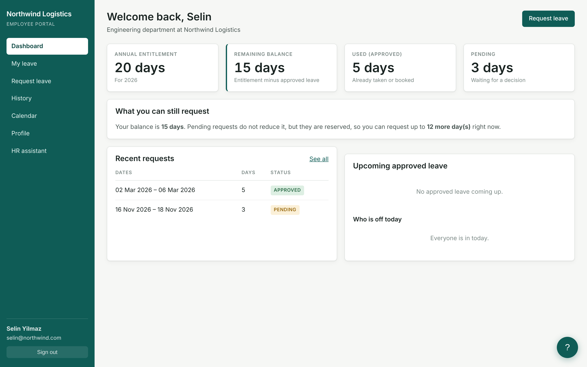
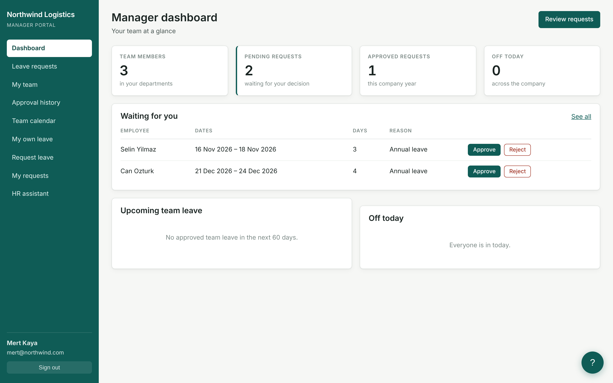
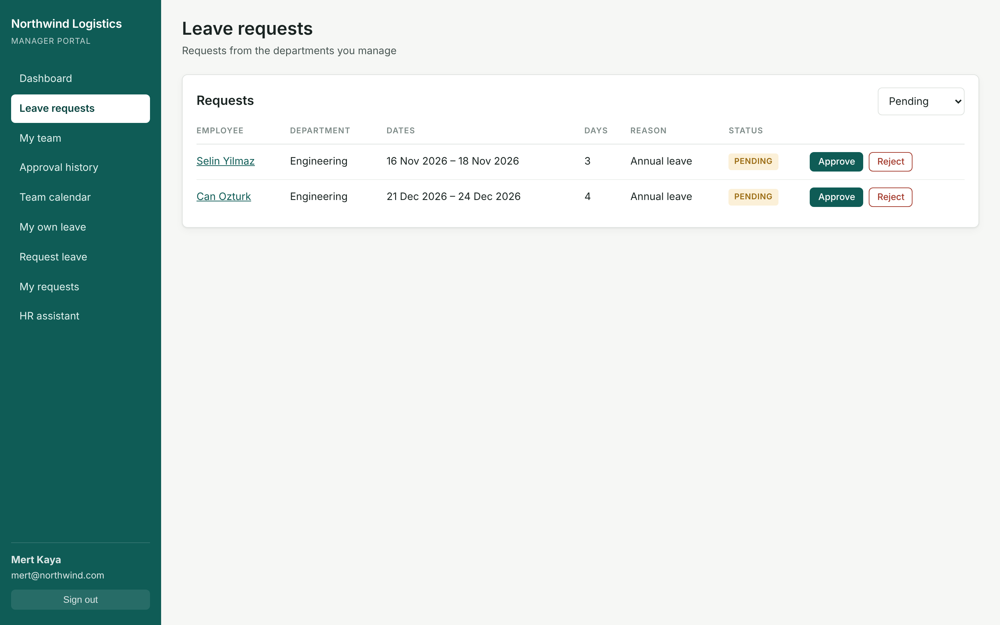
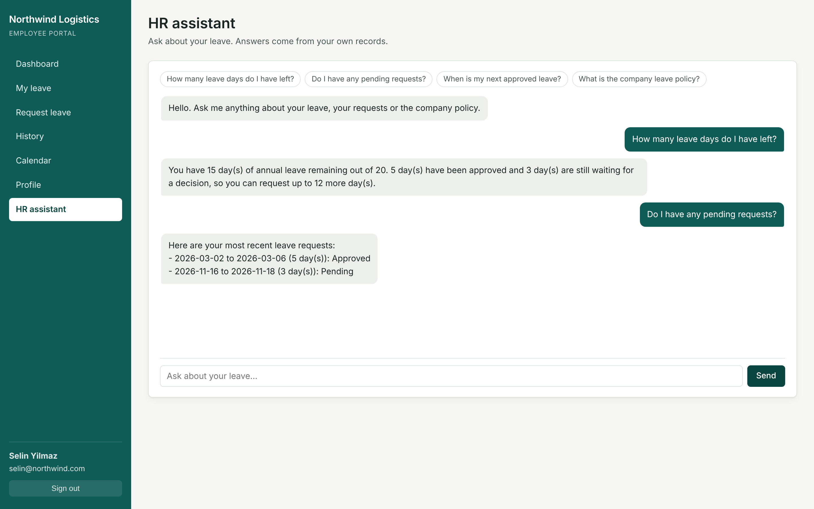

# HR Management System

A full-stack employee leave-management application built with **Node.js, Express, and PostgreSQL**. It supports multiple companies, with separate data access and dedicated interfaces for employees, managers, and administrators.

**Technologies:** Node.js · Express · PostgreSQL · HTML · CSS · JavaScript

## Screenshots

| Employee Dashboard | Manager Dashboard |
|---|---|
|  |  |

| Leave Request Approval | HR Assistant |
|---|---|
|  |  |

## Features

- **Employees:** View leave balances, submit or cancel pending requests, track request status, and access the company leave calendar.
- **Managers:** Review, approve, or reject requests and manage leave for their departments.
- **Administrators:** Manage employees, departments, leave policies, annual entitlements, and public holidays.
- **AI Assistant:** Answer questions about leave information using authorized database queries.
- **Multi-tenancy:** Support multiple companies with company-scoped data access.
- **Security:** JWT authentication, role-based authorization, input validation, and protected API routes.

## Installation

**Requirements:** Node.js 18+ and PostgreSQL 14+.

Clone the repository and install dependencies:

```bash
git clone https://github.com/nehanarwan/hr-management-system.git
cd hr-management-system
npm install
```

Create the databases:

```bash
createdb hr_saas
createdb hr_saas_test
```

Configure the environment:

```bash
cp .env.example .env
cp .env.test.example .env.test
```

Update `.env` with your database connection and a secure JWT secret. Update `.env.test` with the same database password, pointing at `hr_saas_test`.

| Variable | Purpose |
|---|---|
| `PORT` | Server port |
| `DATABASE_URL` | PostgreSQL connection string |
| `JWT_SECRET` | Secret used to sign authentication tokens |
| `JWT_EXPIRES_IN` | Token lifetime (default: `1d`) |
| `ANTHROPIC_API_KEY` | Optional; enables the AI assistant |
| `CORS_ORIGINS` | Optional; permitted origins |

A suitable secret can be generated with:

```bash
node -e "console.log(require('crypto').randomBytes(48).toString('hex'))"
```

The application validates these variables at startup and stops with an explanatory message if a required one is missing.

Run the migrations, seed demonstration data, and start the application:

```bash
npm run migrate:up
npm run seed
npm run dev
```

Open `http://localhost:3000`.

## Demonstration Accounts

The seed script creates two sample companies for testing role permissions and tenant isolation.

**Password for all accounts:** `password123`

| Company | Email | Role |
|---|---|---|
| Northwind Logistics | `admin@northwind.com` | Administrator |
| Northwind Logistics | `mert@northwind.com` | Manager |
| Northwind Logistics | `selin@northwind.com` | Employee |
| Bluepeak Health | `jonas@bluepeak.com` | Manager |
| Bluepeak Health | `amara@bluepeak.com` | Employee |

*For local development and testing only. Never use demonstration credentials in production.*

## Architecture

The application uses a layered architecture that separates HTTP handling, business logic, and database operations.

```text
Browser (HTML, CSS, JavaScript)
              |
              v
        Express Server
              |
     Authentication & Authorization
              |
       Routes & Controllers
              |
           Services
              |
              v
          PostgreSQL
```

**Project structure**

```text
src/
├── config/        Database and environment configuration
├── middlewares/   Authentication and validation
├── modules/       Application features and business logic
├── utils/         Shared helpers
├── app.js         Application configuration
└── server.js      Server startup

public/            Frontend files
migrations/        Database migrations
scripts/           Database seed script
tests/             Automated tests
docs/              Architecture notes and screenshots
```

## Database Design

```text
companies ──┬── users ──────────┐
            │                   │
            ├── departments ────┼── employees ──┬── leave_balance
            │       ▲           │      ▲        │
            │       └───────────┼──────┘        └── leave_request ── request_response
            │      manager_id   │  user_id
            ├── leave_policies
            └── holidays
```

| Table | Contents |
|---|---|
| `companies` | One record per tenant company |
| `users` | Login accounts; unique per company and email address |
| `employees` | Employee records, linked to a user account and a department |
| `departments` | Departments, each with an assigned manager |
| `leave_balance` | Annual entitlement per employee per year |
| `leave_request` | Requests with status Pending, Approved, Rejected, or Cancelled |
| `request_response` | Approval history: reviewer, decision, reason, and timestamp |

The schema is built by four sequential migration files. Composite foreign keys such as `(company_id, employee_id)` and check constraints such as `remaining_days = total_days - used_days` move key correctness guarantees into the database itself.

## Key Implementation Details

### Multi-tenancy and security

- Each authenticated user is associated with a company.
- Database queries are scoped to the authenticated user's company.
- Composite foreign keys prevent records from referencing an entity in another company at the database level.
- Role permissions are enforced on the server, not just in the interface.
- Users cannot access another company's records or approve their own leave requests.
- Unauthorized cross-company record requests return HTTP 404.

### Leave management

The system distinguishes between available balance and requestable leave:

```text
Balance     = Entitlement − Approved Leave
Requestable = Entitlement − Approved Leave − Pending Leave
```

Leave is calculated using working days, with weekends and company holidays excluded according to policy.

Approvals use database transactions and row locking to protect balance calculations during concurrent requests. The system also validates overlapping requests, notice periods, consecutive-day limits, and calendar-year boundaries.

### AI assistant

The assistant uses authorized application tools to retrieve relevant information from PostgreSQL. Tool access is restricted by user role, and personal leave queries use the authenticated user's identity.

When no AI API key is configured, a rule-based responder provides the supported functionality.

## API Overview

Protected endpoints require:

`Authorization: Bearer <token>`

| Method | Endpoint | Purpose |
|---|---|---|
| POST | `/api/auth/register` | Register a company |
| POST | `/api/auth/login` | Authenticate a user |
| GET | `/api/auth/me` | Get the current user |
| GET | `/api/leave/my-balance` | View leave balance |
| GET, POST | `/api/leave/requests` | List or submit requests |
| PATCH | `/api/leave/requests/:id/cancel` | Cancel a pending request |
| GET | `/api/manager/leave-requests` | View requests for review |
| PATCH | `/api/manager/leave-requests/:id/approve` | Approve a request |
| PATCH | `/api/manager/leave-requests/:id/reject` | Reject a request |
| GET | `/api/calendar` | View the leave calendar |
| POST | `/api/chat` | Query the HR assistant |

## Testing

```bash
npm test
```

The project includes **32 tests** covering:

- Authentication, authorization, and tenant isolation
- Leave calculations, approvals, and rejections
- AI assistant tool permissions and access control

Tests run against `hr_saas_test` and apply migrations automatically before execution. A separate database is used because the suite clears all tables before each run.

## Deployment

The repository includes a Docker Compose configuration that runs the application and PostgreSQL together:

```bash
docker compose up --build
docker compose exec app npm run migrate:up
docker compose exec app npm run seed
```

The application is then available at `http://localhost:3000`. The containerised database is separate from any local PostgreSQL instance, and port 5432 must be free before starting.

For production, use secure credentials, HTTPS, and a managed PostgreSQL instance.


## License

MIT — see the `LICENSE` file.