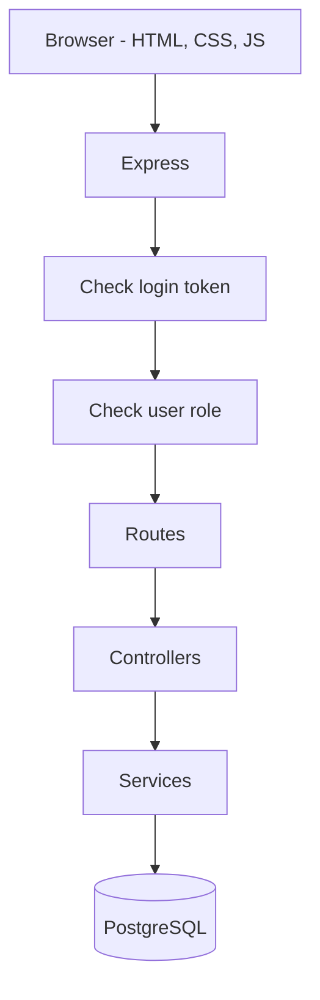
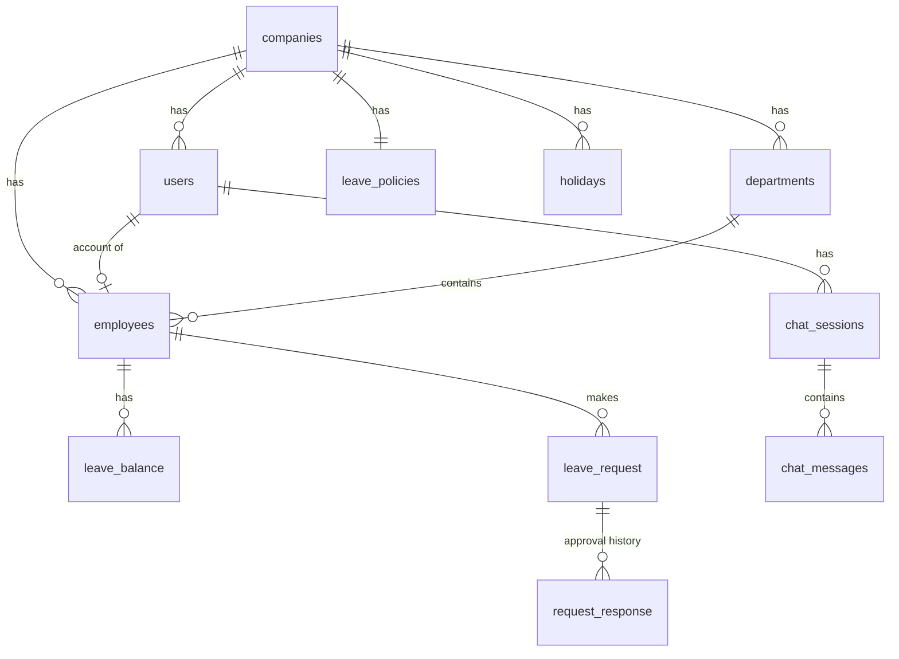
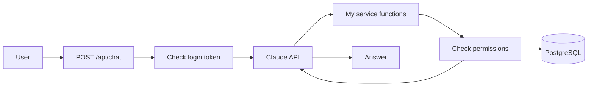

# How the system works

This file explains the main parts of my HR Management System with some diagrams.
The diagrams are written in Mermaid. GitHub shows them as pictures. In VS Code you
need the "Markdown Preview Mermaid Support" extension.

## 1. Request flow

When the user does something on a page, the frontend sends a request to the backend
with `fetch`. The request has the login token (JWT) in the header.

- **Check login token**: the `authenticate` middleware checks the JWT and saves the
  user info in `req.user`.
- **Check user role**: the `authorize` middleware checks if the user is allowed to use
  this route. For example, only managers can approve leave.
- **Services**: this is where the SQL queries are. Every query has
  `WHERE company_id = ...` so one company can never see another company's data.

If something goes wrong, the error goes to one `errorHandler` that sends the error
response. I also use helmet, CORS and a rate limit in Express for basic security.

## 2. Login and company security

Many companies use the same database, so the system must know which company the
user belongs to. This is how it works:

1. The user writes the company name (slug), email and password on the login page.
2. The backend finds the user in that company and checks the password with bcrypt.
3. If it is correct, the backend sends back a JWT. The token has the user id,
   company id, employee id, department id and role inside it.
4. For every next request, the backend takes the company id and employee id from the
   token, not from the browser. So a user cannot ask for another company's data.

**The JWT alone is not enough for security.** The token only tells the backend who
the user is. The real protection is in the services: every database query must
filter by `company_id` from the token. If I forget this in even one query, data
from another company could leak. Because of this, I also test that a user from
one company cannot read or change data from another company.

The token also has an expiry time (`expiresIn` in `jwt.sign`). After it expires,
the user must log in again. This way, a stolen token cannot be used forever.

## 3. Approving a leave request

When a manager approves a leave request, the backend does these checks:

1. The request must be from an employee in the manager's department. If not -> 404.
2. The manager cannot approve their own request. If they try -> 403.
3. The request must still be "Pending". If not -> 400.
4. The employee must have enough leave days left. If not -> 400.
5. If everything is OK, the used days are added to the balance, the status becomes
   "Approved", and a record is saved in the approval history.

All of this runs inside one database transaction (`BEGIN` ... `COMMIT`):

- First, `SELECT ... FOR UPDATE` locks the leave request row and the leave balance
  row. If another manager tries to approve the same request at the same time, they
  must wait until the first transaction is finished.
- Then the backend checks again that the request is still "Pending". This check is
  done after the lock, so two approvals cannot both pass.
- Then the balance, the request status and the history record are updated together.
  Either all three changes are saved with `COMMIT`, or none of them are saved with
  `ROLLBACK`. So the data can never be half updated.

Important rule: a pending request does not change the balance. Only approved leave
reduces it.

## 4. Database tables

- `||--o{` means one-to-many (one company has many employees).
- `||--||` means one-to-one (one company has one leave policy).
- `||--o|` means one-to-zero-or-one (a user may be linked to one employee).

Each department also has a manager, who is one of the employees.

### Important constraints

The database also has rules (constraints) so wrong data cannot be saved, even if
there is a bug in the backend code:

- **Unique email per company**: `UNIQUE (company_id, email)` on `users`. The same
  email cannot be used twice in one company, but two different companies can each
  have a user with that email.
- **One leave balance per employee per year**: `UNIQUE (employee_id, year)` on
  `leave_balance`. So an employee cannot have two balances for the same year.
- **No cross-company relationships**: the foreign keys include `company_id`, for
  example `FOREIGN KEY (company_id, department_id) REFERENCES departments
  (company_id, id)`. This means an employee can only belong to a department from
  the same company, and a leave request can only belong to an employee from the
  same company.

## 5. Extra feature: HR assistant (chatbot)

The chatbot uses the Claude API. It does not have access to the database directly.
Instead it can only call some functions (tools) that I wrote.

- **Employees** can ask about their own leave balance, their requests, their upcoming
  leave and the leave policy.
- **Managers and admins** can also ask about their team's pending requests, the team
  leave calendar and an employee's leave balance.

**The backend checks permissions for every tool call.** Claude does not decide
which data the user is allowed to see. For example:

- The company id and employee id always come from the user's token, not from Claude.
- If an employee asks about another employee's balance, they do not get the manager
  tools, so Claude cannot call them.
- If a manager asks about an employee, the tool function checks that this employee
  is in the manager's department and in the same company. If not, it returns an
  error instead of the data.

So even if Claude makes a mistake or a user tries to trick it, the user can only get
data they are already allowed to see in the normal pages.